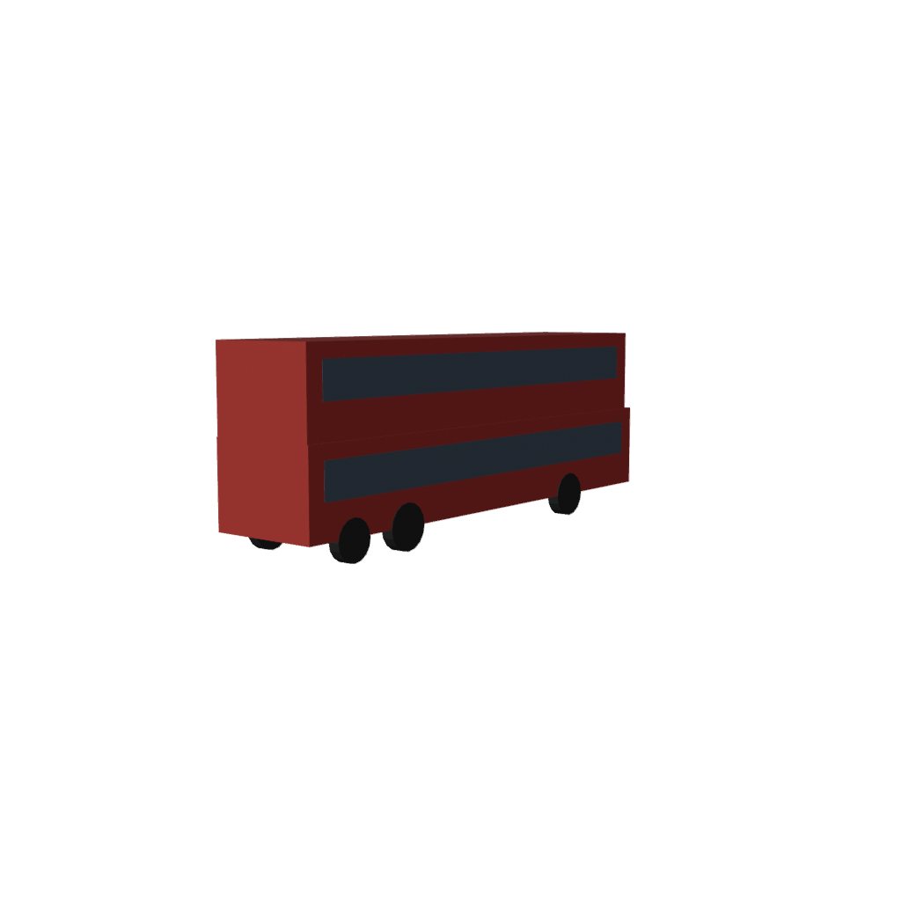

# 香港全境 1:1 真實道路 Assetto Corsa Map Tools

這個 repository 是一個用來製作 1:1 香港全境真實道路與真實駕駛環境的 Assetto Corsa project。The project currently provides reproducible 1:1 real road data、route data、Blender generation scripts、FBX export helper，以及 Assetto Corsa track skeleton。

> **Current status / 目前狀態:** 目前輸出是可重建的 1:1 全境真實道路 blockout and project skeleton，不是完成品或可直接發布的 final KN5 track。A finished 1:1 real-world map still requires survey data、terrain、collision、AI lines、traffic assets and final ksEditor authoring。

## Project scope / 專案範圍

地圖涵蓋 1:1 香港全境真實道路 / The map focuses on full Hong Kong real-world roads；各區共用同一個 shared road world，完全依據現實地理數據建置：

1. **Hong Kong Island / 香港島:** 港島核心區、主要幹道及山頂真實道路。
2. **Kowloon / 九龍:** 九龍各主要幹道、考試路線及市區真實街道網。
3. **New Territories / 新界:** 新界公路、鄉郊快道及真實山區公路。

完整中文 instructions 位於 `asset\routes\full_hk.json`，而 Blender generator 使用對應的 English road identifiers。

| Item / 項目 | Value / 值 |
| --- | --- |
| Map purpose / 用途 | 1:1 香港全境真實道路駕駛與模擬 / 1:1 Full Hong Kong real-world driving routes |
| Survey group / 資料圖組 | 全香港真實測量數據 / Full Hong Kong real survey data |
| Reference sheet / 參考圖幅 | `HK-FULL` |
| Assetto Corsa map ID | `full_hk` |
| Road strategy / 道路策略 | One shared road world based strictly on real-world GIS and OSM data |
| Sheet strategy / 圖幅策略 | Follow full Hong Kong boundaries |

全香港真實測量數據配合 1:1 高精度縮放，提供真實沉浸式模擬體驗。

## Repository structure / 目錄結構

```text
.
├── README.md
├── .gitignore
├── asset/
│   ├── routes/full_hk.json
│   ├── assetto_corsa/full_hk/
│   │   ├── models.ini
│   │   ├── data/surfaces.ini
│   │   ├── ui/ui_track.json
│   │   └── README.md
│   └── vehicles/hk_double_decker_bus/
├── auto/v1/                  # CSDI/Blender automation and web tools
├── build/HK_FULL/
│   ├── source/source_manifest.json
│   └── full_hk/
│       ├── routes.json
│       ├── tile_manifest.json
│       └── full_hk_blockout.blend
├── car/driving test car/     # Driving-test vehicle references
├── config/                   # Vehicle and map configuration
├── content/cars/             # Assetto Corsa car content
├── docs/                     # Production plans and ACROSS catalog
└── tools/
    ├── build_map.ps1
    ├── desktop_export.ps1
    ├── fetch_hk_data.py
    ├── across_catalog.py
    └── blender/
        ├── generate_full_hk.py
        └── export_full_hk_fbx.py

Downloader-generated roads.osm.json and roads.geojson are ignored by Git，因為它們可以重新下載；they remain locally under build\HK_FULL\source\ as generator inputs。
One-command build / 一鍵建圖
在 repository root 開啟 PowerShell / Open PowerShell at the repository root：
.\tools\build_map.ps1

The pipeline 會執行以下步驟 / performs the following steps：
 * Run tools\fetch_hk_data.py and download nearby OSM roads through Overpass API。
 * Convert the response to GeoJSON，並使用 local cache。
 * Run tools\blender\generate_full_hk.py in Blender background mode。
 * Generate/update the .blend blockout、routes.json and tile_manifest.json。
 * Check Blender and ksEditor availability，並顯示 KN5 export 的下一步。
Known local installations / 已知本機安裝位置：
C:\Program Files\Blender Foundation\Blender 5.1\blender.exe
A:\SteamLibrary\steamapps\common\assettocorsa\sdk\editor\ksEditor.exe

build_map.ps1 會先 search PATH，找不到才使用 fallback paths；if your installation differs，請修改 $blenderPath and $ksEditorPath。
Downloader safety / 下載器保護
tools\fetch_hk_data.py 對公開 API 採取 conservative request policy：
 * At most one request at a time / 同一時間最多一個請求。
 * Minimum 15-second interval / 新請求前至少等待 15 秒。
 * Reuse local cache / 有效 roads.osm.json 時不重新下載。
 * Maximum three retries with exponential backoff / 失敗時最多重試三次並逐步延遲。
 * No parallel downloads、endpoint scanning or repeated bulk requests / 不使用並行下載、API 掃描或重複大量請求。
 * 不會爬取 Google Maps tiles 或下載 Street View assets / Google Maps tiles and Street View assets are never scraped or downloaded。
如要強制重新下載，先確認 service terms and rate limits / confirm the service terms and rate limits first，再執行 / then run：
Remove-Item .\build\HK_FULL\source\roads.osm.json
Remove-Item .\build\HK_FULL\source\roads.geojson
python .\tools\fetch_hk_data.py

Data sources / 資料來源
| Source / 來源 | Purpose / 用途 | Usage / 使用方式 |
|---|---|---|
| GeoInfo Map | Official Hong Kong map、roads、buildings and terrain reference | Official/manual reference |
| eHongKongStreet | GeoPDF street maps and sheet calibration | Use original-size data for accurate calibration |
| OpenStreetMap Overpass | Real road centerlines and road names | Automated download；遵守 ODbL attribution |
| Google Maps | Current-condition comparison | Manual reference only；no scraping or asset extraction |
Before publishing a mod，請重新確認 official-data non-commercial terms、OSM attribution requirements and Google Maps terms。OSM blockout data is not a substitute for official survey geometry。
Blender generator / Blender 生成器
可直接執行 / Run directly：
& "C:\Program Files\Blender Foundation\Blender 5.1\blender.exe" `
  --background `
  --python .\tools\blender\generate_full_hk.py

The generator 會清理 scene、讀取 build\HK_FULL\source\roads.geojson、將 WGS84 coordinates 轉成 local metre grid、建立真實 1:1 road strips and basic markings，然後輸出：
build\HK_FULL\full_hk\full_hk_blockout.blend
build\HK_FULL\full_hk\routes.json
build\HK_FULL\full_hk\tile_manifest.json

如果 GeoJSON 不存在，generator 使用少量 built-in anchors 作 pipeline fallback / uses a small built-in anchor fallback；this fallback is for testing only，不代表完整或精確道路資料 / it is not a complete or accurate road dataset。
FBX and KN5 export / 匯出流程
執行 / Run：
.\tools\desktop_export.ps1

Helper 會檢查 .blend、Blender 和 official SDK ksEditor，要求使用者輸入 EXPORT，再輸出：
build\HK_FULL\full_hk\full_hk.fbx

之後會開啟 ksEditor / ksEditor will then open。User must load the FBX、檢查 materials/coordinates、再手動 export full_hk.kn5 / manually export the KN5；the helper does not use blind screen coordinates and will not overwrite existing output automatically。
Assetto Corsa skeleton / AC 檔案骨架
Track skeleton 位於 asset\assetto_corsa\full_hk\ / The track skeleton is located there：
 * models.ini loads full_hk.kn5。
 * data\surfaces.ini contains initial ROAD and GRASS surfaces。
 * ui\ui_track.json contains menu metadata。
 * README.md explains installation and export notes。
2 GB sheet-splitting rule / 2 GB 分片規則
Treat 2 GB as the hard per-model limit，and 1.5 GB as the safety target：
 * Under limit / 未超過：full_hk.kn5
 * Over limit / 超過：full_hk-1.kn5、full_hk-2.kn5
 * More parts / 更多分片：full_hk-3.kn5、full_hk-4.kn5
Only oversized source sheets are split。分片應按同一 region 內的 actual real road content 建立，不使用任意固定 100 x 100 metre grid，並保持 tile_manifest.json and models.ini 一致。
Other repository projects / 其他專案內容
Repository 亦包含 broader Hong Kong Assetto Corsa work：
 * auto/v1/: CSDI/Blender automation、vehicle data、templates and web pages / CSDI/Blender 自動化、車輛資料、模板和網頁。
 * asset/vehicles/hk_double_decker_bus/: Hong Kong double-decker bus OBJ、MTL and manifest / 香港雙層巴士模型和 manifest。
 * car/driving test car/: driving-test vehicle reference data / 駕駛考試車輛參考資料。
 * config/vehicles.json: vehicle configuration index / 車輛設定索引。
 * docs/: map-production plans and ACROSS fleet data / 地圖製作計劃和 ACROSS 車隊資料。
 * tools/across_catalog.py: ACROSS fleet-catalog generator / ACROSS 車隊 catalog 生成器。
重新生成 ACROSS catalog / Regenerate the catalog：
python .\tools\across_catalog.py --output .\build\across --cache .\build\across-cache

ACROSS counts may include historical、spare、training or retired vehicles，不能直接視為 operator current active fleet。
Validation / 驗證
python -m py_compile `
  .\tools\fetch_hk_data.py `
  .\tools\blender\generate_full_hk.py `
  .\tools\blender\export_full_hk_fbx.py

python -c "import json; json.load(open('asset/routes/full_hk.json', encoding='utf-8')); json.load(open('asset/assetto_corsa/full_hk/ui/ui_track.json', encoding='utf-8')); print('JSON valid')"

git diff --check

已驗證的項目包括 Python syntax、route/manifest JSON parsing、cached OSM download、Blender background generation、FBX export and ksEditor path detection / Validated items include all of these steps。
Known limitations / 已知限制
正式完成 1:1 全境真實地圖仍需要 / A finished real-world map still requires：
 * Full-size Hong Kong GIS calibration。
 * Correct Hong Kong 1980 Grid or survey-coordinate conversion。
 * Elevation、contours and terrain meshes。
 * Accurate road width、lane markings、curbs and junction geometry。
 * Traffic lights、signs、guardrails、bus stops and roadside props。
 * Buildings、distant scenery and collision meshes。
 * Assetto Corsa AI lines、pits、spawns and timing lines。
 * CSP/night lighting、reflection settings、final KN5 and in-game testing。
Current .blend is a development starting point for a 1:1 full Hong Kong real-world simulation，not a complete map / 目前 .blend 只是 1:1 全境真實模擬的開發起點，並非完整地圖。
Contribution workflow / 修改流程
 * Keep source URLs、download dates and license notes when changing data sources。
 * Avoid parallel or repeated requests to public APIs。
 * Model overlapping real roads once。
 * Do not merge unrelated Hong Kong areas into one oversized model without splitting。
 * Check every KN5 file size and apply the sheet naming rule。
 * Run Python、JSON and git diff --check validation after changes。
License and disclaimer / 授權及免責
本 repository 的 scripts and configuration 是地圖製作工具，不會自動授予第三方 map data、government data、OSM data 或 Google Maps assets 的再發布權。Before publishing a mod，請遵守每個來源各自的 license、attribution、non-commercial and service-term requirements。

---

---

## 🛣️ 全部路試路線 / All Road Test Routes

完整路線資料庫：`asset/routes/all_road_test_routes.json`（**13 個試場、31 條路線**）

> ⚠️ 報名時只能選擇「香港區」或「九龍及新界區」，考場由運輸署隨機分配，不可指定；考前不會告知路線，需熟悉該考場所有路線。路線由考牌主任按實際交通情況可臨時更改，僅供參考。

### 香港島考場 / Hong Kong Island

| 試場 Centre | 車輛 Classes | 路線數 | 難度 |
|---|---|---|---|
| 跑馬地 Happy Valley | 1, 1A | 2 | 中等偏低 |
| 掃桿埔 So Kon Po | 2, 2A | 4 | 中等 |
| 柴灣常安街 Sheung On St | 17, 17A | 1 (已驗證) | 中等 |

### 九龍考場 / Kowloon

| 試場 Centre | 車輛 Classes | 路線數 | 難度 |
|---|---|---|---|
| 天光道 Tin Kwong Road | 1, 1A, 2, 2A | 3 (已驗證) | 高（全港最難之一） |
| 忠義街 Chung Ngai St | 1, 1A, 2, 2A | 2 | 高 |
| 培正道 Pui Ching Road | 1, 1A, 2, 2A | 4 | 高 |
| 永孝街 Wing Hau St | 1, 1A, 2, 2A | 2 | 中等 |
| 油塘 Yau Tong | 2, 2A | 2 | 中等偏易 |

### 新界考場 / New Territories

| 試場 Centre | 車輛 Classes | 路線數 | 難度 |
|---|---|---|---|
| 石蔭 Shek Yam | 1, 1A, 2, 2A | 2 | 低 |
| 荃灣德士古道 Texaco Rd | 3, 3A, 4, 17, 17A | 3 | 高（公認最難之一） |

### 駕校考場 / Driving Schools

| 試場 Centre | 路線數 | 難度 |
|---|---|---|
| 鴨脷洲 Ap Lei Chau | 2 | 低（全港最易之一） |
| 元朗 Yuen Long | 2 | 低 |
| 沙田 Sha Tin | 2 | 中等 |

### 已驗證路線詳情 / Verified Routes

**天光道路線一**：試埸開出 → 左轉天光道 → 右轉靠背壟道 → 左轉落山道 → 右轉美善同道 → 右轉江蘇街 → 右轉靠背壟道 → 左轉天光道 → 右轉常康街（調頭）→ 左轉常盛街 → 左轉天光道 → 右轉入試場

**天光道路線二**：試埸開出 → 左轉天光道 → 右轉常盛街 → 右轉常康街（調頭）→ 左轉常盛街 → 右轉天光道 → 左轉馬頭圍道 → 左轉農圃道 → 右轉天光道 → 右轉入試場

**天光道路線三**：試埸開出 → 右轉天光道 → 左轉亞皆老街 → 左轉嘉齡道 → 右轉巴富街 → 左轉石鼓街 → 左轉常盛街 → 右轉常康街（調頭）→ 左轉常盛街 → 左轉天光道 → 右轉入試場

**柴灣常安街路線一**：試埸開出 → 右轉常安街 → 左轉豐業街 → 右轉新業街 → 右轉柴灣道 → 左轉永平街 → 左轉新廈街 → 泳池掉頭 → 右轉永平街 → 左轉柴灣道 → 右轉怡順街 → 右轉怡豐街 → 右轉金源里 → 左轉柴灣道 → 左轉常安街 → 駛回試場

> 資料來源：driving.com.hk（天光道/柴灣，已驗證）、apasshk.com 全港考場路線分析、YouTube 學車王/鏗鏘駕駛學校（荃灣德士古道）。其餘路線為參考資料，實際以考牌主任當日決定為準。

---

## 🚙 考車 3D 模型 / Exam Vehicle 3D Models

6 款考車的 1:1 程序化 3D 車身 + 完整物理數據，位於 `content/cars/`。
1:1 procedural 3D bodies + full physics data for all 6 exam vehicles.

### 車輛清單 / Vehicle List

| 類別 Class | 車輛 Vehicle | 車身 Body | 引擎 Engine | 波箱 Gearbox | 馬力/扭力 | 車重 |
|---|---|---|---|---|---|---|
| **1** | Toyota Yaris (XP130) | hatchback | 1.5L 1NZ-FE | C50 5MT | 107hp / 140Nm | 1,100 kg |
| **1A** | Toyota Prius (ZVW30/50) | hatchback | 1.8L 2ZR-FXE + MG2 | e-CVT | 121hp / 163Nm | 1,435 kg |
| **2** | Toyota HiAce (GDH201) | van | 2.8L 1GD-FTV 柴油 | R151 5MT | 177hp / 420Nm | 2,600 kg* |
| **2A** | Toyota HiAce (GDH201R) | van | 2.8L 1GD-FTV 柴油 | AC60E 6AT | 177hp / 450Nm | 2,600 kg* |
| **17** | ADL Enviro500 Gen 1 | 雙層巴士 | Cummins ISLe340 8.9L | Voith/ZF 半自動 | 340hp / 1,500Nm | 14,200 kg |
| **17A** | ADL Enviro500 MMC Gen 2 | 雙層巴士 | Cummins L9 8.9L Euro 6 | ZF EcoLife 6AT | 340hp / 1,500Nm | 15,100 kg |

\* 2/2A 考試時須預載 ~600–700 kg 壓載重物（運輸署規定）。

### 每車檔案結構 / Per-Car File Structure
```text
content/cars/<car_id>/
├── data/                  # 物理數據 (由 generate_car_data.py 生成)
│   ├── car.ini            # 車重、軸距、輪距、尺寸、轉向鎖
│   ├── engine.ini         # 馬力/扭力 + power curve
│   ├── drivetrain.ini     # 齒輪比、尾牙、自動/手動
│   ├── suspension.ini     # 懸掛類型、彈簧率、避震
│   ├── tyres.ini          # 輪胎尺寸、胎壓、抓地力
│   └── brakes.ini         # 煞車碟尺寸、前後分配、ABS
├── ui/ui_car.json         # 選車界面資料 + 規格
├── skins/default/         # 車身塗裝 (body.dds, plate.dds)
├── body.fbx               # 1:1 3D 車身 (gitignored, 可再生)
└── preview.png            # 3D 預覽圖 (已提交)
```

### 生成流水線 / Generation Pipeline
```text
python tools/generate_car_data.py
    → content/cars/<car_id>/data/*.ini + ui/ui_car.json

blender --background --python tools/blender/generate_car_bodies.py
    → content/cars/<car_id>/body.fbx + preview.png

ksEditor: body.fbx → <car_id>.kn5
    → content/cars/<car_id>/<car_id>.kn5
```

### 預覽 / Previews

| 私家車 (1) | 輕型貨車 (2) | 雙層巴士 (17A) |
|---|---|---|
|  |  |  |

完整車輛清單與規格：`content/cars/cars_manifest.json`

---

## 🚦 交通車輛清單 / Traffic Vehicle List

完整的香港交通車輛規劃目錄（**101 台**）：[docs/traffic_vehicle_list.md](docs/traffic_vehicle_list.md)

### 目標車流比例 / Target Traffic Mix

| 類別 | 數量 | 佔比 |
|---|---:|---:|
| 🚗 私家車 Private | 60 | 60% |
| 🚚 商用車 Commercial | 25 | 25% |
| 🚨 公共/特殊 Public & Special | 15 | 15% |

### 精選重點 / Highlights
- **私家車**：Toyota Corolla/Camry/Prius/Alphard、Honda Civic/Accord/Fit、Nissan Note/Serena、Tesla Model 3/Y、BMW 3系、Mercedes C-Class 等 60 款
- **商用車**：的士（Crown Comfort Taxi）、HiAce、NV200、Canter 貨車、Isuzu 輕型貨車、冷凍車、水泥車等 25 款
- **公共/特殊**：警車、救護車、消防車、政府車、學車車、保安巡邏車等 15 款
- **已有原型**：`hk_double_decker_bus`（雙層巴士低多邊形原型，10.6m）

> 資料來源：`config/vehicles.json`（規劃目錄）。巴士/客車/小巴明確排除於交通車流範圍。全部車輛（除雙層巴士原型外）仍需原創或可再發布授權的 3D 模型。

---

## 🗺️ 多試場地圖 / Multi-Centre Maps

除天光道外，HD 地圖流水線現已支援所有主要試場。已預先生成：

| 試場 Centre | 抽取道路 Ways | 斑馬線 | 地圖 FBX | 預覽 |
|---|---:|---:|---:|---|
| 天光道 Tin Kwong Road | 5,578 | 337 | 18.2 MB | ✓ |
| 柴灣常安街 Sheung On Street | 1,669 | 87 | 7.1 MB | ✓ |
| 荃灣德士古道 Texaco Road | 7,589 | 378 | 21.3 MB | ✓ |

### 多試場指令 / Multi-Centre Commands
```powershell
# 列出所有試場
python tools\prepare_hd_map.py --list

# 抽取試場走廊數據 (可一次多個)
python tools\prepare_hd_map.py sheung_on_street texaco_road

# 生成 HD 地圖 (指定試場)
blender --background --python tools\blender\generate_hd_map.py -- texaco_road

# 渲染預覽
blender --background --python tools\blender\preview_hd_map.py -- texaco_road
```

### 其他可用試場 / Other Available Centres
`happy_valley` (跑馬地)、`so_kun_po` (掃桿埔)、`shek_am` (石蔭)、`yau_tong` (油塘) — 座標已配置，隨時可生成。

---

## 🤖 AI 路線 / AI Splines

3 個試場嘅 AI 路線已生成（V7 格式，`fast_lane.ai`）：

| 試場 | 節點數 | 檔案大小 | 位置 |
|---|---:|---:|---|
| 天光道 | 61,540 | 5.5 MB | `content/tracks/hong_kong_1to1/ai/fast_lane.ai` |
| 柴灣常安街 | 17,376 | 1.5 MB | `content/tracks/hong_kong_1to1_sheung_on/ai/fast_lane.ai` |
| 荃灣德士古道 | 61,916 | 5.6 MB | `content/tracks/hong_kong_1to1_texaco/ai/fast_lane.ai` |

### 生成方式 / Generation
```powershell
python tools\generate_ai_spline.py              # 全部
python tools\generate_ai_spline.py texaco_road  # 指定試場
```

- 從 OSM 道路中心線取樣（每 2 米一點）
- 貪婪最近鄰鏈接成單一閉合 spline
- 優先主幹道/次要道路/住宅道路（跳過行人路）
- 格式：AC V7（version=7, pos+length+id, 附加 speed/radius/normal/forward）
- 格式已用 AssettoServer FastLaneParser 驗證

### 備註 / Notes
- AI 線係「全路網單一 spline」（覆蓋所有可駕駛道路）
- 如需賽道式 AI（跟住賽道線），可後續加入 `ai_spline` 或 junction 系統
- 速度預設 50 km/h 市區；可喺生成器改 `MAX_SPEED`