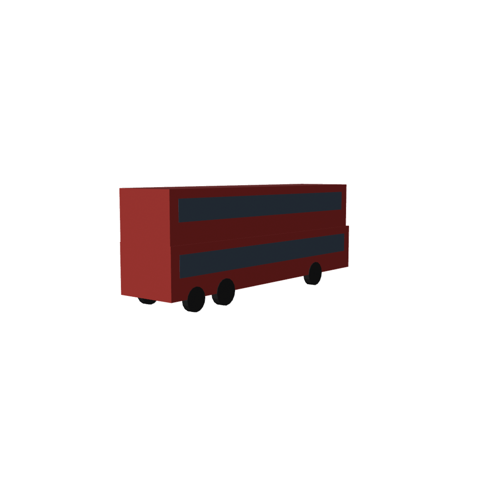

# 香港 1:1 Assetto Corsa 地圖

Hong Kong road-map authoring and regional track experiments.

The goal is to recreate all of Hong Kong at **1:1 scale** in Assetto Corsa,
released as separate regional tracks. The scope includes the catalogue's
**13 driving-test centres and 31 route records**. Several of those records
still need route and location verification.

**Current status · November 26, 2026.** The territory-wide source master and
detailed Kam Tin inputs are prepared, and the browser picker covers **61
regions**. The last local installation check found **Kam Tin
`0.3-full-loop`**, a provisional 3.445 km driving loop. The full Hong Kong
release is still in development. The next playable milestone is the **431 m
section between Kam Tin checkpoints 1 and 2**, with accurate road edges,
continuous collision and improved roadside buildings. **Route Twisk RWE /
Repack Test** is the visual benchmark. [Kam Tin building review](projects/hk01_kam_tin/BUILDING_REVIEW.md)

## Start here / 從這裏開始

| Workstream / 工作 | Current scope / 目前範圍 | Guide / 文件 |
| --- | --- | --- |
| Region picker / 地圖選區 | Select a 6 × 6 km area and prepare its terrain, road lines and building footprints | [Open the region picker](#region-picker--地圖選區) |
| Kam Tin / 錦田 | Provisional 3.445 km loop available on the development PC. Checkpoint 1–2 quality pass in development. | [Project README](projects/hk01_kam_tin/README.md) · [Status](projects/hk01_kam_tin/STATUS.md) · [Testing](projects/hk01_kam_tin/TESTING.md) |
| Required map quality / 地圖品質目標 | Route Twisk reference standard and outstanding road, junction and scenery work | [Quality requirements](projects/hk01_kam_tin/REFERENCE_QUALITY.md) |
| Map source data / 地圖來源資料 | Whole-Hong-Kong master and regional inputs; detailed Kam Tin full-loop terrain, maps, imagery and buildings | [Full-HK master](projects/hk01_kam_tin/FULL_HONG_KONG.md) · [Data locations](projects/hk01_kam_tin/MAP_DATA.md) |
| Earlier road-test tools / 早期考場工具 | Tin Kwong Road blockout and multi-centre experiments | Historical development notes below; [production plan](docs/map-production-plan.md) |

## Region picker / 地圖選區

The picker follows the Earth2Cities workflow. Choose a real-world area in the
browser, then prepare its source layers. It opens on Kam Tin and displays the
mapped road network and approximate driving-test centre locations.
[Earth2Cities on Paradox Mods](https://mods.paradoxplaza.com/mods/140919/Windows)

With the local source master prepared, run these commands in PowerShell from
the repository root. On a fresh checkout, install the Python dependencies,
run `python projects/hk01_kam_tin/scripts/fetch_sources.py --foundation`,
then follow the [source master setup](projects/hk01_kam_tin/FULL_HONG_KONG.md#rebuild-the-master).

```powershell
python projects/hk01_kam_tin/scripts/build_region_picker.py
Invoke-Item projects/hk01_kam_tin/gis/hong_kong_master/region_picker.html
```

Click a region, then copy and run the PowerShell command shown beside the
map. It prepares a terrain crop, road lines and review data, building
footprints and shared road boundary points for that area. These files are
inputs for Blender and track authoring. The generated picker, geographic
data and game assets stay local.
[Regional authoring guide](projects/hk01_kam_tin/FULL_HONG_KONG.md#pick-an-area-on-the-map)

## Kam Tin regional map / 錦田區域地圖

The long-term goal is real-scale Hong Kong driving, delivered as separate regional tracks using shared geographic data. Whole-territory road references are not a finished, seamless game world.

- Regional authoring uses Hong Kong 1980 Grid coordinates (EPSG:2326), with one Blender unit per metre.
- The historical v0.5 comparison build added photographed asphalt and ground, worn paint, cutout foliage and visual safety rails while retaining the baseline collision and spawns.
- Road profiles, junctions, kerbs, drainage, accurate roadside placement, local vegetation and building/ground seams remain unfinished. Coarse collision remains behind the visual rails.
- File, geometry, texture and installed-hash checks are recorded in the project reports. They do not establish live handling, engine lighting or FPS. AI traffic, night/rain tuning and multiplayer remain unverified for this loop.

For the existing local build, select **Hong Kong — Kam Tin Driving Test** (`hk01_kam_tin_test`) in **Practice**, with one car, clear daytime and a pit start. Restart the session after replacing models; follow the eight blue test markers and record defects and FPS using the [testing guide](projects/hk01_kam_tin/TESTING.md).

For authoring, use Blender 5.1 or later and the Python dependencies in [scripts/requirements.txt](projects/hk01_kam_tin/scripts/requirements.txt), installed in a virtual environment. Run the project's commands from `projects/hk01_kam_tin/`, following its [rebuild prerequisites](projects/hk01_kam_tin/README.md#rebuild). Later build stages require retained source snapshots and earlier local scenes; a fresh clone alone is insufficient. Review [PUBLISHING.md](projects/hk01_kam_tin/PUBLISHING.md) before packaging or installation.

## Repository layout / 目錄結構

```text
projects/hk01_kam_tin/          Regional map source, configuration and reports
asset/                        Earlier map/car templates and route references
content/                      Earlier track/car configurations and previews
apps/lua/hk_exam/              Experimental road-test guidance app
config/                       Vehicle, route and traffic configuration
tools/                        Map, data-import and validation tools
auto/v1/                      Earlier CSDI/Blender and vehicle experiments
```

The current Kam Tin publishing workflow keeps downloaded geographic inputs, generated Blender scenes, models, textures, archives and backups local. Existing tracked reference/configuration files are retained; their presence does not make a complete installable mod.

## Earlier map tools / 早期地圖工具

`tools/build_map.ps1` builds the **Tin Kwong Road** blockout through `tools/blender/generate_tin_kwong.py`. `tools/desktop_export.ps1` exports its local scene through `tools/blender/export_tin_kwong_fbx.py` and opens ksEditor for manual KN5 authoring. These are not a `full_hk` generator or the Kam Tin v0.5 pipeline. Inspect the configured Blender/game paths before using them.

The separate multi-centre pipeline is `tools/prepare_hd_map.py` → `tools/blender/generate_hd_map.py` → `tools/build_tracks.py`. The last script normally installs into existing configured AC track folders; use `--no-install` for a build-only run. These earlier procedural outputs do not meet the current regional quality target.

## Sources and distribution / 資料及發布

Follow the [Kam Tin attribution](projects/hk01_kam_tin/ATTRIBUTION.md), its retained source manifests and the [publishing guide](projects/hk01_kam_tin/PUBLISHING.md). Keep source URLs, timestamps and checksums with derived data. Scripts and configuration do not grant redistribution rights to third-party map data, bus models, artwork or sounds. The installed Route Twisk reference assets are not copied into Kam Tin.

## Historical development notes / 歷史開發紀錄

The sections below retain the earlier road-test, vehicle and traffic experiments. Counts, installed-output statements and static validation results describe those development stages; they are not current download guarantees or proof of in-game quality. The Kam Tin status above describes the current map work.

---

## 🛣️ 全部路試路線 / All Road Test Routes

完整路線資料庫：`asset/routes/all_road_test_routes.json`（**13 個試場、31 條路線**）

> ⚠️ 報名時只能選擇「香港區」或「九龍及新界區」，考場由運輸署隨機分配，不可指定；考前不會告知路線，需熟悉該考場所有路線。路線由考牌主任按實際交通情況可臨時更改，僅供參考。

### 香港島考場 / Hong Kong Island

| 試場 Centre | 車輛 Classes | 路線數 | 難度 |
|---|---|---|---|
| 跑馬地 Happy Valley | 1, 1A | 2 | 中等偏低 |
| 掃桿埔 So Kon Po | 2, 2A | 4 | 中等 |
| 柴灣常安街 Sheung On St | 17, 17A | 1 (已驗證) | 中等 |

### 九龍考場 / Kowloon

| 試場 Centre | 車輛 Classes | 路線數 | 難度 |
|---|---|---|---|
| 天光道 Tin Kwong Road | 1, 1A, 2, 2A | 3 (已驗證) | 高（全港最難之一） |
| 忠義街 Chung Ngai St | 1, 1A, 2, 2A | 2 | 高 |
| 培正道 Pui Ching Road | 1, 1A, 2, 2A | 4 | 高 |
| 永孝街 Wing Hau St | 1, 1A, 2, 2A | 2 | 中等 |
| 油塘 Yau Tong | 2, 2A | 2 | 中等偏易 |

### 新界考場 / New Territories

| 試場 Centre | 車輛 Classes | 路線數 | 難度 |
|---|---|---|---|
| 石蔭 Shek Yam | 1, 1A, 2, 2A | 2 | 低 |
| 荃灣德士古道 Texaco Rd | 3, 3A, 4, 17, 17A | 3 | 高（公認最難之一） |

### 駕校考場 / Driving Schools

| 試場 Centre | 路線數 | 難度 |
|---|---|---|
| 鴨脷洲 Ap Lei Chau | 2 | 低（全港最易之一） |
| 元朗 Yuen Long | 2 | 低 |
| 沙田 Sha Tin | 2 | 中等 |

### 已驗證路線詳情 / Verified Routes

**天光道路線一**：試埸開出 → 左轉天光道 → 右轉靠背壟道 → 左轉落山道 → 右轉美善同道 → 右轉江蘇街 → 右轉靠背壟道 → 左轉天光道 → 右轉常康街（調頭）→ 左轉常盛街 → 左轉天光道 → 右轉入試場

**天光道路線二**：試埸開出 → 左轉天光道 → 右轉常盛街 → 右轉常康街（調頭）→ 左轉常盛街 → 右轉天光道 → 左轉馬頭圍道 → 左轉農圃道 → 右轉天光道 → 右轉入試場

**天光道路線三**：試埸開出 → 右轉天光道 → 左轉亞皆老街 → 左轉嘉齡道 → 右轉巴富街 → 左轉石鼓街 → 左轉常盛街 → 右轉常康街（調頭）→ 左轉常盛街 → 左轉天光道 → 右轉入試場

**柴灣常安街路線一**：試埸開出 → 右轉常安街 → 左轉豐業街 → 右轉新業街 → 右轉柴灣道 → 左轉永平街 → 左轉新廈街 → 泳池掉頭 → 右轉永平街 → 左轉柴灣道 → 右轉怡順街 → 右轉怡豐街 → 右轉金源里 → 左轉柴灣道 → 左轉常安街 → 駛回試場

> 資料來源：driving.com.hk（天光道/柴灣，已驗證）、apasshk.com 全港考場路線分析、YouTube 學車王/鏗鏘駕駛學校（荃灣德士古道）。其餘路線為參考資料，實際以考牌主任當日決定為準。

---

## 🚙 考車 3D 模型 / Exam Vehicle 3D Models

6 款考車的 1:1 程序化 3D 車身 + 完整物理數據，位於 `content/cars/`。
1:1 procedural 3D bodies + full physics data for all 6 exam vehicles.

### 車輛清單 / Vehicle List

| 類別 Class | 車輛 Vehicle | 車身 Body | 引擎 Engine | 波箱 Gearbox | 馬力/扭力 | 車重 |
|---|---|---|---|---|---|---|
| **1** | Toyota Yaris (XP130) | hatchback | 1.5L 1NZ-FE | C50 5MT | 107hp / 140Nm | 1,100 kg |
| **1A** | Toyota Prius (ZVW30/50) | hatchback | 1.8L 2ZR-FXE + MG2 | e-CVT | 121hp / 163Nm | 1,435 kg |
| **2** | Toyota HiAce (GDH201) | van | 2.8L 1GD-FTV 柴油 | R151 5MT | 177hp / 420Nm | 2,600 kg* |
| **2A** | Toyota HiAce (GDH201R) | van | 2.8L 1GD-FTV 柴油 | AC60E 6AT | 177hp / 450Nm | 2,600 kg* |
| **17** | ADL Enviro500 Gen 1 | 雙層巴士 | Cummins ISLe340 8.9L | Voith/ZF 半自動 | 340hp / 1,500Nm | 14,200 kg |
| **17A** | ADL Enviro500 MMC Gen 2 | 雙層巴士 | Cummins L9 8.9L Euro 6 | ZF EcoLife 6AT | 340hp / 1,500Nm | 15,100 kg |

\* 2/2A 考試時須預載 ~600–700 kg 壓載重物（運輸署規定）。

### 每車檔案結構 / Per-Car File Structure
```text
content/cars/<car_id>/
├── data/                  # 物理數據 (由 generate_car_data.py 生成)
│   ├── car.ini            # 車重、軸距、輪距、尺寸、轉向鎖
│   ├── engine.ini         # 馬力/扭力 + power curve
│   ├── drivetrain.ini     # 齒輪比、尾牙、自動/手動
│   ├── suspensions.ini     # 懸掛類型、彈簧率、避震
│   ├── tyres.ini          # 輪胎尺寸、胎壓、抓地力
│   └── brakes.ini         # 煞車碟尺寸、前後分配、ABS
├── ui/ui_car.json         # 選車界面資料 + 規格
├── skins/default/         # 車身塗裝 (body.dds, plate.dds)
├── body.fbx               # 1:1 3D 車身 (gitignored, 可再生)
└── preview.png            # 3D 預覽圖 (已提交)
```

### 生成流水線 / Generation Pipeline
```text
python tools/generate_car_data.py
    → content/cars/<car_id>/data/*.ini + ui/ui_car.json

blender --background --python tools/blender/generate_car_bodies.py
    → content/cars/<car_id>/body.fbx + preview.png

ksEditor: body.fbx → <car_id>.kn5
    → content/cars/<car_id>/<car_id>.kn5
```

### 預覽 / Previews

| 私家車 (1) | 輕型貨車 (2) | 雙層巴士 (17A) |
|---|---|---|
|  |  |  |

完整車輛清單與規格：`content/cars/cars_manifest.json`

---

## 🚦 交通車輛清單 / Traffic Vehicle List

完整的香港交通車輛規劃目錄（**101 台**）：[docs/traffic_vehicle_list.md](docs/traffic_vehicle_list.md)

### 目標車流比例 / Target Traffic Mix

| 類別 | 數量 | 佔比 |
|---|---:|---:|
| 🚗 私家車 Private | 60 | 60% |
| 🚚 商用車 Commercial | 25 | 25% |
| 🚨 公共/特殊 Public & Special | 15 | 15% |

### 精選重點 / Highlights
- **私家車**：Toyota Corolla/Camry/Prius/Alphard、Honda Civic/Accord/Fit、Nissan Note/Serena、Tesla Model 3/Y、BMW 3系、Mercedes C-Class 等 60 款
- **商用車**：的士（Crown Comfort Taxi）、HiAce、NV200、Canter 貨車、Isuzu 輕型貨車、冷凍車、水泥車等 25 款
- **公共/特殊**：警車、救護車、消防車、政府車、學車車、保安巡邏車等 15 款
- **已有原型**：`hk_double_decker_bus`（雙層巴士低多邊形原型，10.6m）

> 資料來源：`config/vehicles.json`（規劃目錄）。巴士/客車/小巴明確排除於交通車流範圍。全部車輛（除雙層巴士原型外）仍需原創或可再發布授權的 3D 模型。

---

## 🗺️ 多試場地圖 / Multi-Centre Maps

HD 地圖流水線現已支援全部 **13 個試場**，所有地圖已生成並安裝到 AC：

| 試場 Centre | 區域 Area | 抽取道路 Ways | KN5 大小 | AI 節點 |
|---|---|---:|---:|---:|
| 天光道 Tin Kwong Road | 九龍土瓜灣 | 5,578 | 69.3 MB | 3,394 |
| 柴灣常安街 Sheung On Street | 港島柴灣 | 1,669 | 26.5 MB | 2,775 |
| 荃灣德士古道 Texaco Road | 新界荃灣 | 7,589 | 81.3 MB | 7,870 |
| 跑馬地 Happy Valley | 港島 | 1,719 | 32.5 MB | 3,403 |
| 掃桿埔 So Kun Po | 港島 | 1,807 | 29.9 MB | 1,543 |
| 石蔭 Shek Am | 新界葵涌 | 2,074 | 30.4 MB | 551 |
| 油塘 Yau Tong | 九龍 | 1,258 | 18.4 MB | 2,043 |
| 忠義街 Chung Ngai Street | 九龍何文田 | 4,264 | 48.7 MB | 3,744 |
| 培正道 Pui Ching Road | 九龍何文田 | 3,774 | 45.7 MB | 4,739 |
| 永孝街 Wing Hau Street | 九龍土瓜灣 | 2,861 | 36.4 MB | 3,394 |
| 鴨脷洲 Ap Lei Chau | 港島南區 | 1,104 | 14.1 MB | 2,159 |
| 元朗南生圍 Yuen Long | 新界元朗 | 585 | 11.1 MB | 1,367 |
| 沙田小瀝源 Sha Tin | 新界沙田 | 2,849 | 34.8 MB | 1,047 |

### 多試場指令 / Multi-Centre Commands
```powershell
# 列出所有試場
python tools\prepare_hd_map.py --list

# 抽取試場走廊數據 (可一次多個)
python tools\prepare_hd_map.py sheung_on_street texaco_road

# 生成 HD 地圖 (指定試場)
blender --background --python tools\blender\generate_hd_map.py -- texaco_road

# 轉換 KN5 (無需 ksEditor)
blender --background --python tools\blender\export_kn5_direct.py -- build\HP1C\texaco_road\hd_map.fbx build\HP1C\texaco_road\hd_map.kn5

# 渲染預覽
blender --background --python tools\blender\preview_hd_map.py -- texaco_road
```

---

## 🤖 AI 路線 / AI Splines

全部 13 個試場嘅 AI 路線已生成（V7 格式，`fast_lane.ai`），採用**動態速度**：

| 試場 | 節點數 | 速度範圍 | 檔案大小 |
|---|---:|---|---:|
| 天光道 | 3,394 | 32-50 km/h | 305 KB |
| 柴灣常安街 | 2,775 | 18-50 km/h | 249 KB |
| 荃灣德士古道 | 7,870 | 16-50 km/h | 707 KB |
| 跑馬地 | 3,403 | 16-50 km/h | 306 KB |
| 掃桿埔 | 1,543 | 18-50 km/h | 139 KB |
| 石蔭 | 551 | 32-50 km/h | 50 KB |
| 油塘 | 2,043 | 17-50 km/h | 184 KB |
| 忠義街 | 3,744 | 17-50 km/h | 336 KB |
| 培正道 | 4,739 | 17-50 km/h | 426 KB |
| 永孝街 | 3,394 | 32-50 km/h | 305 KB |
| 鴨脷洲 | 2,159 | 16-50 km/h | 194 KB |
| 元朗 | 1,367 | 34-50 km/h | 123 KB |
| 沙田 | 1,047 | 39-50 km/h | 94 KB |

### 生成方式 / Generation
```powershell
python tools\generate_ai_spline.py              # 全部 13 個
python tools\generate_ai_spline.py texaco_road  # 指定試場
```

- 從 OSM 道路中心線取樣（每 2 米一點）
- 貪婪最近鄰鏈接成單一閉合 spline（MAX_GAP=100m，支援反向端點）
- **動態速度**：根據彎路半徑計算 `v = √(μ·g·r)`（μ=0.4 保守市區摩擦）
- 速度平滑 + 加速限制（每點最多 ±5 km/h）
- 格式：AC V7（version=7, pos+length+id, 附加 speed/radius/normal/forward）
- 格式已用 AssettoServer FastLaneParser 驗證

### 備註 / Notes
- AI 線係「全路網單一 spline」（覆蓋所有可駕駛道路）
- 直路 50 km/h，急彎自動減速到 16-40 km/h
- 如需賽道式 AI（跟住賽道線），可後續加入 `ai_spline` 或 junction 系統

---

## 📋 考試系統 / HK Exam System

CSP Lua app，提供路試路線指引同評分（`apps/lua/hk_exam/`）：

| 功能 | 說明 |
|---|---|
| 路線資料庫 | **31 條路線**，涵蓋全部 13 個試場 |
| 評分系統 | 起始 100 分，70 分合格 |
| 超速扣分 | -5 / -10 / -15 分（視乎超速程度） |
| 碰撞扣分 | -15 分（速度突降偵測） |
| 無故停車 | -5 分（停車超過 3 秒） |
| 自動步進 | 按行駛距離自動推進步驟（可設定） |
| 轉向指示 | 支援 16 種轉向類型（L/R/迴旋處/掉頭/斜路起步等） |
| 成績總結 | 合格/不合格、時間、距離、扣分明細 |

### 安裝 / Installation
```powershell
# 複製到 AC（已安裝）
Copy-Item "apps\lua\hk_exam\*" "A:\SteamLibrary\steamapps\common\assettocorsa\apps\lua\hk_exam\" -Recurse -Force
```

### 使用 / Usage
1. 開 AC → Drive → 揀 HK 試場
2. App 側欄啟用 **HK Exam System**
3. 揀路線 → 按「開始考試」
4. 綁定快捷鍵（AC controls）：
   - `APP_HK_EXAM_START` — 開始考試
   - `APP_HK_EXAM_END` — 結束考試
   - `APP_HK_EXAM_NEXT` — 下一步

### 即時香港數據 / Live HK Open Data

| 數據 | 來源 | 用途 |
|---|---|---|
| 特別交通消息 | 運輸署 `resource.data.one.gov.hk/td/tc/specialtrafficnews.xml` | App 內顯示即時意外/封路/工程（分類 + 顏色） |
| 巴士路線（歷史 snapshot：KMB 1,605 + CTB 410） | `data.etabus.gov.hk`、`rt.data.gov.hk` | 當時每個試場對應 16–106 條路線；需重新整理資料 |

更新指令：

```powershell
python tools\fetch_td_news.py --lang tc     # 交通消息 -> config + td_news.lua
python tools\build_bus_routes.py            # 路線目錄 -> config/bus_routes_hk.json
python tools\gen_bus_routes_lua.py          # -> apps/lua/hk_exam/bus_routes.lua
```

### 賽道控制節點 / Track Control Nodes

每個賽道 KN5 由 export_kn5_direct.py 自動生成 AC 必要節點（否則車無法起步、無圈速）：

| 節點 | 作用 |
|---|---|
| AC_START_0 | 起步點（AI spline 起點，朝向沿線） |
| AC_PIT_0..3 | 4 個維修站（起步點後方橫向偏移） |
| AC_TIME_0_L/R | 起點計時閘 |
| AC_TIME_1_L/R | 中途分段計時閘 |

### 輔助賽道資料 / Aux Track Data

`tools/gen_track_aux_data.py` 由 `fast_lane.ai` 邊界框生成：

- data/map.ini — 小地圖範圍（2 px/m）
- data/lighting.ini — 日照角度 / 環境光
- data/audio_sources.ini — 城市環境音
- data/ai_hints.ini — AI 剎車提示（預留）

### 車輛物理深度 / Car Physics Depth

每部考車 37 個 data 檔案，對照真實 AC 車輛（47 檔）逐項補齊：

| 檔案 | 內容 |
|---|---|
| `tyres.ini` | AC v10 完整 Pacejka 輪胎模型：RADIUS/RIM_RADIUS/ANGULAR_INERTIA、DY0/DY1、DX0/DX1、WEAR_CURVE、RELAXATION_LENGTH、ROLLING_RESISTANCE_0/1/SLIP、FLEX、CAMBER_GAIN、DCAMBER_0/1、XMU、7 個 PRESSURE_* 、FZ0、LS_EXPY/EXPX、DX/DY_REF、FALLOFF_*、THERMAL[0..1] 熱學 |
| engine.ini | POWER/COAST 曲線、INERTIA、LIMITER、[DAMAGE] 區段 |
| drivetrain.ini | 傳動型式（Yaris/Prius FWD、HiAce/E500 RWD）、波箱換檔時間、[TRANSMISSION] 自動離合器、[CLUTCH] 扭力上限 |
| suspensions.ini | [BASIC] 軸距/重心分佈、[ARB] 防傾桿、每軸 BASEY/ROD_LENGTH/HUB_MASS、漸進彈簧、緩衝塊行程、快慢阻尼 |

重型車（>8000 N 輪胎負載）自動用更硬避震（damp 900、rate 620k、慣性 2.6）、
62 psi 胎壓、3 倍滾動阻力。

### 表面物理 / Surface Physics

`tools/gen_track_surfaces.py` 直接讀取 KN5 材質表，為每個材質生成對應嘅
surfaces.ini 區段（AC 靠 KEY 同 mesh 材質名配對）：

| 材質 | 摩擦 | 有效賽道 | 揚塵 |
|---|---:|---|---:|
| HK_asphalt / _dark | 0.98 | 是 | 0 |
| HK_line_white / _yellow / HK_zebra_white | 0.99 | 是 | 0 |
| HK_kerb | 0.95（震動 0.1 / 0.2） | 否 | 0 |
| HK_grass | 0.62 | 否 | 6 |
| HK_tree_trunk | 0.45 | 否 | 8 |
| HK_building_* | 0.40（阻尼 0.9） | 否 | 10 |

之前只有單一 KEY=ROAD，完全對不上材質名，全張地圖都用預設表面
（草地有路面抓地力、建築物可行車、路肩無震動）。現時 13 個賽道各有
13 個正確表面。

### 一鍵重建 / One-Command Rebuild

`tools/build_tracks.py` 串連整條流水線並在失敗時停低：

```powershell
python tools\build_tracks.py                  # 全部 13 個試場
python tools\build_tracks.py sha_tin yau_tong # 指定試場
python tools\build_tracks.py --skip-osm       # 重用現有 OSM 提取
python tools\build_tracks.py --no-install     # 只建置，不安裝
```

步驟：OSM 提取 → Blender HD mesh → FBX→KN5（含控制節點）→ AI spline
→ traffic.json → map/lighting/audio ini → KN5 驗證 → 安裝到 AC。

### KN5 格式驗證 / KN5 Validation

`tools/validate_kn5.py` 係一個完整 KN5 v6 解析器，會逐個 byte 讀到檔案結尾，
檢查 header / textures / materials / node tree / mesh：

```powershell
python tools\validate_kn5.py --tracks    # 13 個賽道（要求 AC_START/AC_PIT/AC_TIME）
python tools\validate_kn5.py --cars      # 6 部車（車身 + collider）
python tools\validate_kn5.py path\to\x.kn5
```

修正過嘅三個二進位格式錯誤（會令 AC 靜默丟棄 mesh）：

1. Dummy node 多寫 1 byte flag（正確：`type + name + children + matrix(64)`）
2. Mesh node 應為 3 個 flag byte（cast_shadows, is_visible, is_transparent）
3. Mesh trailer 應為 32 bytes（1 int + 4 floats + 2 floats）

現時 13/13 賽道（0.24M-2.03M 頂點、0.68M-5.29M 三角形）同 12/12 車輛模型
全部通過完整解析。

### 技術 / Technical
- CSP 0.2.11 Lua app（`manifest.ini` + `script.windowMain/update`）
- 全部 21 個 API 已對照 CSP SDK（`extension/internal/lua-sdk/ac_apps/lib.lua`）驗證
- 路線由 `asset/routes/all_road_test_routes.json` 自動生成 `routes.lua`

---

## 🚗 交通模式 / CSP Traffic Mode

全部 13 個試場已加入 CSP Traffic mode 所需配置：

- `data/traffic.json`：由每個試場嘅 AI spline + OSM 道路數據自動生成分段、雙向 traffic lanes 同路口（junctions；長跳點自動切段，路口只保留同 ≥2 條車道相交者；OSM junction=traffic_signals 路口套用 Basic 交通燈程序）
- `#traffic-planner-ready`：UI layout tag，令 CSP Traffic mode 顯示該試場
- `[_SCRIPTING_PHYSICS] ALLOW_NEW_MODE_SCRIPTS=1`：允許 Traffic mode 修改物理
- Traffic car 模型由 CSP Traffic Tool 管理；首次使用可讓 CSP 自動下載官方 traffic data

### 使用 / Usage
1. 開 AC → Practice → 揀任何 `Hong Kong 1:1` 試場
2. 選擇 CSP **Traffic** game mode（如未見到，先重啟 Content Manager）
3. 設定交通密度（Traffic mode 預設最多 1,500 部）
4. 開始後，車輛會沿試場 traffic lanes 行駛；已閉合路段會循環，開放路段會由 CSP graph 入口/出口管理

### 交通車輛 / Traffic Cars

CSP Traffic mode 而家可以用 22 款真實香港交通車（config/traffic_cars.json 登記）：

- 私家車：Toyota Camry/Alphard/Celica、Honda Jazz、Mercedes A45、Nissan GT-R、Porsche Macan、Tesla Model 3、VW Golf R 等
- 的士/小巴/巴士：Crown Comfort、Prius Taxi、Coaster、Volvo Olympian、機場巴士
- 貨車：Isuzu Giga/NPR、Mule Truck、F&F Truck
- 電單車：GSXR-1000

執行 python tools/install_traffic_cars.py 將 LOD C 模型複製入 CSP Traffic Tool data/ 並生成 CarDefinition JSON。

### 建築物 / Buildings

各試場已加入 OSM 建築物立體模型（`tools/fetch_buildings.py` 下載、generate_hd_map.py 擠出）：

| 試場 | 建築物 |
|---|---:|
| 天光道 | 4,480 |
| 忠義街 | 4,147 |
| 培正道 | 3,871 |
| 德士古道 | 3,706 |
| 永孝街 | 1,954 |
| 跑馬地 | 1,805 |
| 掃桿埔 | 1,773 |
| 石蔭 | 1,522 |
| 沙田 | 1,047 |
| 油塘 | 647 |
| 鴨脷洲 | 611 |
| 常安街 | 455 |
| 元朗 | 256 |

合共 **26,274** 個建築物。

建築物按 OSM 類型自動分材質與高度：

- 高度優先序：height tag -> `building:levels x 3.1 m` -> 類型預設（住宅 36m / 公寓 42m / 商業 45m / 辦公 60m / 工業 16m / 學校 16m / 屋 9m）
- 6 種材質：住宅、公寓、高塔、商業、工業、公共機構
- 另加 **樹木**（trunk + 雙層樹冠）同 **綠化區**（草地/公園/球場/花園）

| 試場 | 建築物 | 樹木 | 綠化區 |
|---|---:|---:|---:|
| 天光道 | 4,705 | 405 | 418 |
| 忠義街 | 4,274 | 95 | 284 |
| 培正道 | 4,015 | 100 | 288 |
| 德士古道 | 3,902 | 129 | 378 |
| 永孝街 | 2,097 | 87 | 226 |
| 跑馬地 | 1,937 | 192 | 157 |
| 掃桿埔 | 1,919 | 179 | 173 |
| 石蔭 | 1,626 | 15 | 151 |
| 沙田 | 1,138 | 34 | 169 |
| 鴨脷洲 | 664 | 36 | 65 |
| 油塘 | 693 | 408 | 79 |
| 常安街 | 555 | 45 | 115 |
| 元朗 | 259 | 0 | 4 |

### 重建交通配置 / Regenerate
```powershell
python tools/generate_traffic_json.py
```

> Traffic JSON 係由 OSM/AI spline 生成嘅分段雙向 traffic lanes + 自動路口；交通燈程序同進階車道連接，可再用 CSP Objects Inspector → Traffic Planner 編輯。
